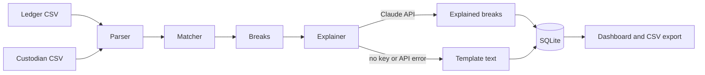

# Trade Reconciliation Tool

Matches an internal trade ledger against a custodian statement, classifies every break, and explains each one in plain English with a suggested next step.

The matching is deterministic Python. The LLM only writes the explanation text for breaks the matcher has already found. It cannot create, remove or reclassify a break.

## How it works



Break types:

| Type | Meaning |
| --- | --- |
| `MISSING_IN_CUSTODIAN` | Trade is in the ledger only |
| `MISSING_IN_LEDGER` | Trade is on the custodian statement only |
| `QUANTITY_MISMATCH` | Same trade ID, different quantity |
| `PRICE_MISMATCH` | Prices differ by more than the tolerance (default 0.0001) |
| `DATE_MISMATCH` | Trade date or settlement date differs |
| `TICKER_MISMATCH` | Different security on the same trade ID |
| `MULTIPLE` | More than one kind of field differs |

## Run it

```
pip install -r requirements-dev.txt
python -m pytest
uvicorn recon.main:app --reload
```

Open http://localhost:8000 and click "Use sample data", or upload `sample_data/ledger.csv` and `sample_data/custodian.csv`.

To use Claude for the explanations, set `ANTHROPIC_API_KEY` before starting the server. The model defaults to `claude-sonnet-4-6` and can be changed with `RECON_MODEL`. Without a key, the app uses template explanations, and the dashboard labels which text came from where.

With Docker:

```
docker build -t trade-recon .
docker run -p 8000:8000 -e ANTHROPIC_API_KEY=your-key trade-recon
```

Generate fresh synthetic data:

```
python -m recon.generator --count 500 --seed 11 --break-rate 0.1 --out sample_data
```

## API

| Method | Path | Purpose |
| --- | --- | --- |
| POST | `/api/reconcile` | Upload `ledger` and `custodian` CSVs, returns the run |
| POST | `/api/demo` | Reconcile generated sample data |
| GET | `/api/runs` | Recent runs |
| GET | `/api/runs/{id}` | One run with all breaks |
| GET | `/api/runs/{id}/export.csv` | CSV report |
| GET | `/api/health` | Health check |

CSV columns: `trade_id, ticker, quantity, price, trade_date, settle_date` (dates as `YYYY-MM-DD`).

## Design decisions

- **LLM is advisory only.** Correctness lives in the matcher and its tests. The model gets the break data and returns JSON; anything malformed, unknown or empty is discarded and replaced with template text.
- **Prices use `Decimal`.** Floats would produce false price breaks.
- **Untrusted output is handled.** The dashboard inserts text with `textContent`, and the CSV export prefixes cells that start with `=`, `+`, `-` or `@` so spreadsheets do not run them as formulas.
- **Synthetic data only.** The generator is seeded, so runs are reproducible, and it produces every break type.
- **The app works without an API key**, so tests and CI never call an external service.

## Limitations

- Trades are matched on `trade_id` only. Real reconciliation often has to match across systems with different IDs using fuzzy keys such as ticker, quantity and date.
- A duplicate `trade_id` within one file is rejected rather than reconciled.
- No authentication, and uploads are capped at 5 MB.
- Price tolerance is a global setting, not per security or currency.
- Explanations name possible causes, not confirmed ones. An analyst still has to verify them.
- Report export is CSV only.

## Project layout

```
recon/        matcher, generator, explainer, db, report, api
static/       dashboard
tests/        pytest suite
sample_data/  generated CSVs
```
